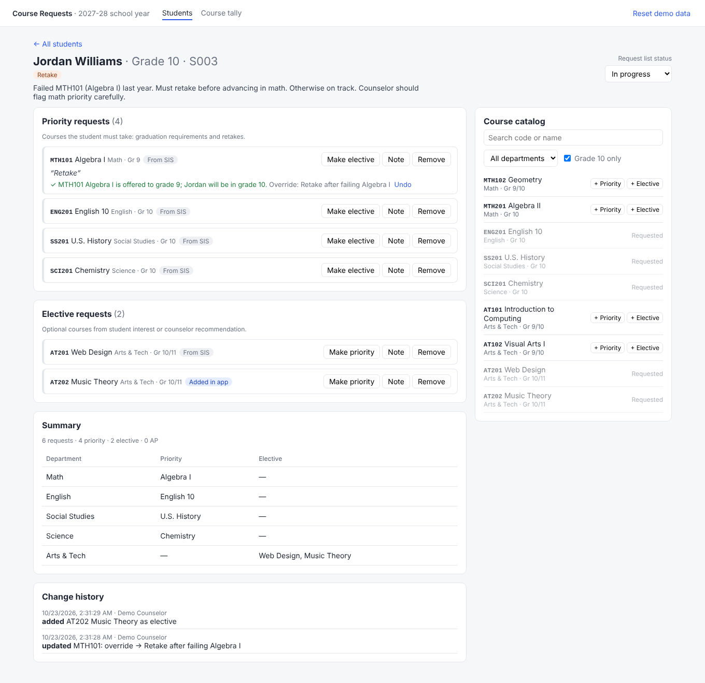

# Course Request Manager (prototype)

A staff-only tool for school counselors and assistant principals to build each student's course
requests for the upcoming school year (2027-28 in the seed data). Built for the Timely Director of
Engineering take-home.

- **Prototype:** FastAPI backend + React/TypeScript frontend, seeded from the exercise appendix.
- **SIS sync design:** [`docs/sis-sync-design.md`](docs/sis-sync-design.md).
- **Decision log:** [`docs/decisions.md`](docs/decisions.md) lists every choice in v1 and what to revisit.



## Run it

Requires Python 3.11+ and Node 18+.

```bash
./dev.sh
```

Then open http://localhost:5173. The first run creates `backend/.venv` and installs npm packages.
The API runs on http://localhost:8000 (interactive docs at http://localhost:8000/docs).

Run each piece by hand:

```bash
# API
cd backend && python3 -m venv .venv && .venv/bin/pip install -r requirements-dev.txt
.venv/bin/uvicorn app.main:app --reload --port 8000

# UI (second terminal; proxies /api to :8000)
cd frontend && npm install && npm run dev

# Tests
cd backend && .venv/bin/pytest
```

Data is in memory. Restarting the API or clicking **Reset demo data** restores the seed.

## What it does

| Screen | What a counselor can do |
| --- | --- |
| **Students** | See the cohort with grade, context flags (ELL, retake, transcript pending, and so on), priority/elective counts, check results, and status. Search and filter by grade, status, or "needs attention". |
| **Student detail** | Read the profile. See requests grouped into Priority and Elective, each marked as "From SIS" or "Added in app". Add from the catalog (filtered to the student's grade by default), switch priority/elective, add a note, or remove. Approve a warning with a reason. Set the list status. See the change history. |
| **Summary** (on the detail page) | One row per department showing priority and elective courses, with missing core departments dimmed. |
| **Course tally** | Requests per course across all students. These counts decide how many sections to offer. |

### MVP choices beyond the brief

- **Checks are warnings, not blocks.** Counselors are the experts and the edge cases are real
  (a 10th grader retaking a 9th-grade course is correct). The tool explains each problem. A
  grade-eligibility warning can be approved with a recorded reason. Only true data errors
  (a course not in the catalog, a duplicate request) block marking a list **Complete**.
- **Provenance on every request.** Each request records whether it came from the SIS or was added
  here, and who last changed it. That's the hook for the SIS sync design. The app has to know
  which requests a counselor has touched before it can sync safely.
- **Per-student status** (Not started, In progress, Needs review, Complete) turns the list into a
  work queue. Any edit moves a list back to In progress.
- **Change history** per student, because several staff touch the same lists in request season.
- **Seed data is loaded as-is, problems included.** The appendix has real SIS-style errors. S008
  requests `SS303`, which isn't in the catalog, and lists `SS402` as both priority and elective. The
  app flags both and suggests likely matches ("Did you mean SS403 Psychology or SS302 Economics?").
  Her profile mentions both electives, so the second `SS402` was probably meant to be Economics.
  Quietly cleaning the seed would hide the problem the tool exists to catch.

### Checks (`backend/app/rules.py`)

| Rule | Severity | Example in seed data |
| --- | --- | --- |
| Course not in catalog (with a suggested match) | Error | S008 `SS303` |
| Duplicate course | Error | S008 `SS402` twice |
| Outside the course's grade range | Warning, can be approved with a reason | S003 retaking `MTH101`; S004 early `AT301`; S006 `MTH401`/`ENG401` as an 11th grader |
| No priority course in a core department | Warning | |
| Fewer than 5 or more than 7 requests | Warning | S010 (3 placeholder requests) |
| More than 3 AP courses | Warning | S006, S009 |
| Transcript or credit review pending | Warning | S010 |

The thresholds are assumptions. They would become per-school settings. Prerequisites, graduation
credit tracking, and real schedule conflicts are out of scope. See "Next steps".

## Architecture

```
frontend/src
  api.ts            CourseRequestApi interface + the HTTP implementation (only file that knows about fetch)
  types.ts          TypeScript mirror of the API models
  components/       StudentList, StudentDetail, CatalogPicker, RequestSummary, Tally

backend/app
  main.py           FastAPI routes (thin: parse, call service, map errors to 404/409/422)
  service.py        CourseRequestService: business logic, status transitions, history
  rules.py          Pure functions: (student, requests, catalog) -> issues
  models.py         Pydantic models; also the API contract
  repositories/
    base.py         ReferenceData (read-only: students, catalog) and RequestRepository (read/write) protocols
    memory.py       Seed-JSON-backed in-memory implementations
  seed/             catalog.json, students.json, requests.json (the requests as the SIS would send them)
```

### How the data source can be swapped

The repository split follows data ownership in production:

- **`ReferenceData`** (students and the catalog) is read-only because the SIS owns it. Today it's
  `SeedReferenceData`. Tomorrow it's a class that reads from our synced copy of SIS data. The
  service never calls the SIS directly.
- **`RequestRepository`** is read/write because counselors own edits in this app. Today it's
  `InMemoryRequestRepository`. Tomorrow it's MongoDB or Postgres.

`build_service()` in `main.py` is the only place that picks implementations. Routes, service, and
rules don't change when the source does. On the frontend, components call `api` (a
`CourseRequestApi`), so a mock or a different backend can replace `httpApi` in one line.

### Pilot speed versus long-term scale

For a pilot, I'd keep this shape and change as little as possible: one Mongo-backed
`RequestRepository`, SSO in front, a nightly SIS import into the reference store, and tenant ID on
every record from day one, since that one is expensive to retrofit. I'd hold off on configurable rule
engines, real-time sync, and multi-school admin until pilot schools show which pain is real.

The seams that matter for scale already exist: the repository interfaces, the rules module, and
the provenance fields. Each costs almost nothing now and is expensive to add later. Everything
else stays simple on purpose so the team can learn from pilot users fast.

## Testing strategy

**Written** (`backend/tests`, 18 tests, run in under a second):

- `test_rules.py`: unit tests for each rule, including edge cases such as an override acknowledging a
  grade warning, seniors only needing English, and duplicates flagging only the later copy.
- `test_api.py`: API tests against a fresh seeded app per test. They cover add/switch/remove,
  provenance and history, 404/409/422 errors, the status gate on errors, and tally counts.

**What I'd add next, in priority order:**

1. **Repository contract tests.** One shared suite that every `RequestRepository` implementation
   must pass (in-memory today, Mongo tomorrow). This is what makes the swap safe.
2. **Rule tests driven by a fixture table** that School Success can read and extend. Each real
   school edge case becomes a row.
3. **Frontend component tests** (Vitest + Testing Library) for `StudentDetail` and `CatalogPicker`,
   with `CourseRequestApi` mocked.
4. **One Playwright smoke test**: open a student, add a course, fix an error, mark complete.
5. **SIS sync tests** built from recorded vendor payloads (see the design doc). Most production
   bugs will come from there.

Types are shared by hand today. Next I'd generate `types.ts` from FastAPI's OpenAPI schema so
the contract can't drift.

## How I used AI

<!-- TODO(Stephen): rewrite in your own words after you review the code. -->

- **Delegated to an AI coding agent (Claude Code):** scaffolding, the first pass of every file,
  seed-data transcription from the PDF, CSS, and test cases.
- **Decided myself:** scope (warnings over blocks, provenance, status, tally), the repository
  split by data ownership, keeping the seed data's errors visible, and the SIS sync approach.
- **How I verified it:** read every diff, ran the test suite, checked the seed data against the
  PDF appendix, and clicked through each screen in a headless browser to confirm the flows work
  with no console errors.

## Next steps

- Auth and roles (counselor, assistant principal, read-only), with staff scoped to their caseload
- Persistence (Mongo, per Timely's stack) and tenant/school scoping
- Prerequisite and graduation-credit checks, which need course history from the SIS
- Alternate electives (ranked backups when an elective is full), common in real request forms
- Bulk actions: apply a grade-level template, copy a course to many students
- Generate frontend types from the OpenAPI schema
- SIS sync, per the design doc
