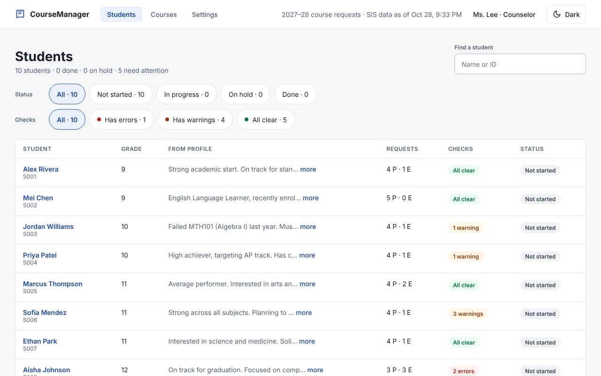
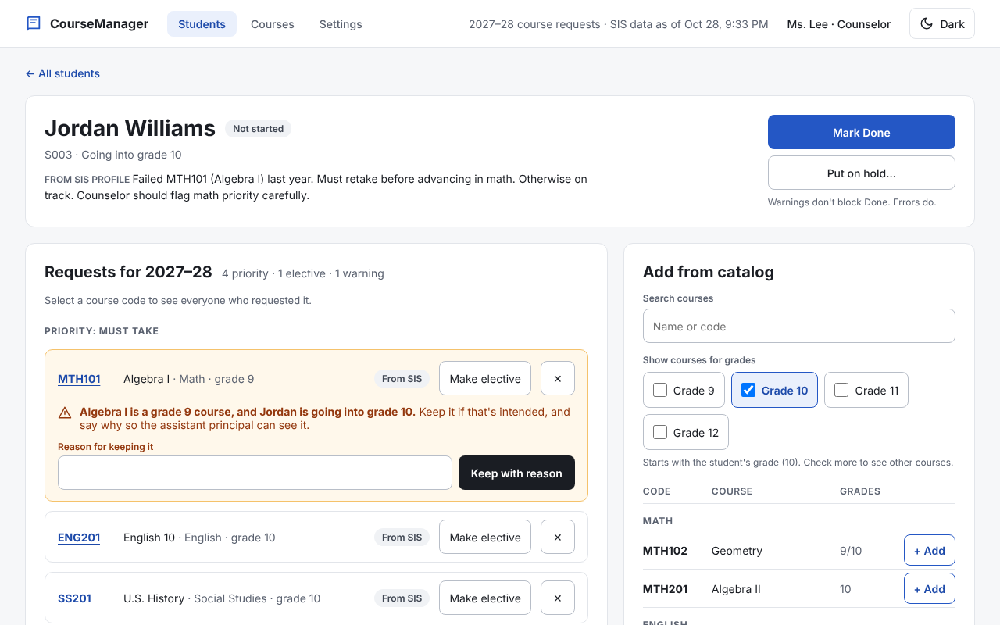
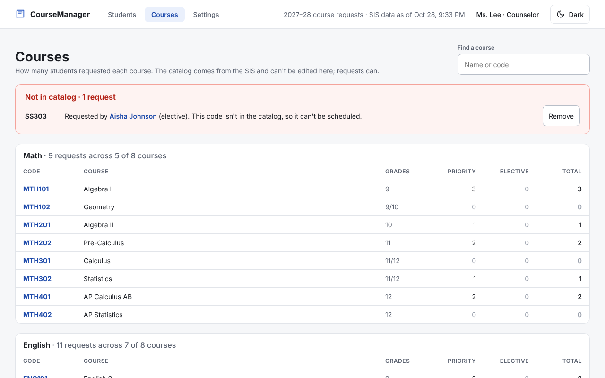
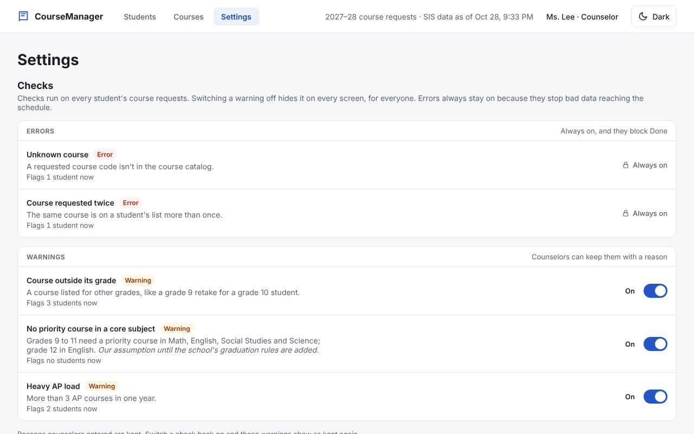

# CourseManager

A localhost prototype of a course request tool for school counselors and assistant principals, plus a design for syncing with a district's SIS. Built for the Timely Director of Engineering take-home.

Counselors review each student's requests for next year, fix bad data from the SIS, add and remove catalog courses, mark each request priority or elective, keep judgment calls with a written reason, and mark a student Done. The SIS sync design is [`docs/sis-sync-design.md`](docs/sis-sync-design.md) ([#20](https://github.com/stephenmayer/CourseManager/pull/20)).

## 1. Run it

You need Python 3.12 with [uv](https://docs.astral.sh/uv/), Node 22 with npm, and GNU make.

```sh
make dev        # installs dependencies, then serves the API on :8000 and the app on :5173
```

Open http://localhost:5173. The first start seeds `backend/data/coursemanager.sqlite3` from the exercise's data (`backend/seed/sis_export.json`). Counselor edits persist across restarts. To start over:

```sh
curl -X POST localhost:5173/api/reset    # or stop the app and delete the .sqlite3 file
```

To run every check:

```sh
make verify     # lint, typecheck and tests for backend and frontend; ends "verify: PASSED at commit <sha>"
```

Ports, layout and the API endpoints are in the [developer guide](docs/process/developer-guide.md).

## 2. What it does

**Students.** Everyone going into next year with their grade, a preview of their SIS profile, request counts, checks and review status. Filter by status and by checks, and search by name or ID.



**Student detail.** Requests grouped priority first. Each check sits on the request it is about, in plain words. Here Jordan is retaking Algebra I, which the catalog lists for grade 9, so the warning asks for a reason the assistant principal can read. On the right, add courses from the catalog, filtered by grade. Errors block Done; warnings don't.



**Courses.** Request counts per course by department, so you can see demand. Codes students requested that aren't in the catalog are listed first. Select a course to see who requested it and fix requests from there.



**Settings.** Switch each warning on or off for everyone. The two data errors stay on.



## 3. Key decisions

Each decision has one file with the options considered, a worked example and the trade-off. The full log is [`docs/decisions/`](docs/decisions/README.md).

- **The data layer is split by who owns the data** ([architecture §1](docs/architecture/overview.md)). Students and the catalog belong to the SIS and are read-only here, behind a `SisSource`. Requests and review status belong to the app, behind a `RequestStore`.
  - **To swap the seed for a real SIS API,** write a new source that returns the same raw export shape (`backend/app/sis/export.py`). The loader, rules, API and UI don't change.
  - **Every import is kept as a versioned snapshot** ([Q18](docs/decisions/q018-sis-import-versioning.md)). The next sync can then tell an SIS change from a counselor's edit.
- [Q1](docs/decisions/q001-out-of-grade-courses.md): A course outside its catalog grade warns. The counselor keeps it with a reason; it is never blocked.
- [Q2](docs/decisions/q002-request-ownership.md): Requests a counselor edited are kept. A later SIS change to one is flagged, never applied over it.
- [Q3](docs/decisions/q003-student-review-status.md): Each student has a review status (Not started, In progress, On hold with a reason, Done). Editing a Done student reopens it.
- [Q4](docs/decisions/q004-priority-core-check.md): Priority is the counselor's label. One stated assumption checks it: each core subject needs a priority course.
- [Q5](docs/decisions/q005-bad-sis-request-data.md): Bad SIS data (an unknown code, a duplicate) loads as-is, shows as an error, and blocks Done until fixed.
- [Q6](docs/decisions/q006-timebox-and-mvp-scope.md): Time box and MVP scope.
- [Q7](docs/decisions/q007-stack.md): FastAPI and React/TypeScript, matching Timely's stack.
- [Q8](docs/decisions/q008-prototype-storage.md): SQLite through the standard library. Tests use a fresh in-memory database. MongoDB can replace the one store class.
- [Q12](docs/decisions/q012-course-view.md): The Courses screen, with counts, a Not-in-catalog list, and fixes from the course side.
- [Q20](docs/decisions/q020-checks-on-off.md): Settings switches warnings off. Errors stay on.

## 4. Testing strategy

- **Rules** (`backend/tests/test_rules.py`). Each check is a pure function, tested on the exercise's own students: Jordan's retake, Sofia's grade-12 courses, Aisha's unknown and duplicate codes, the heavy AP loads. A test also holds every check to the id and severity the Settings screen relies on.
- **API** (`test_api.py`, `test_checks.py`). These go through FastAPI and the service against a fresh in-memory SQLite database per test. They cover adding, removing and switching requests, Done blocked by errors, edits reopening Done, the course counts agreeing with the student list, check switches, reset, and a failed write rolling back.
- **Data layer** (`test_sis_import.py`, `test_request_store.py`). Seed loading, import versioning, soft delete, and adding new tables to an older database.
- **Screens** (Vitest and Testing Library, next to each component). These run with the API client mocked: filters, search, edits, error states and the switches.
- **Every change is test-first.** The failing tests are committed before the code. `make verify` runs everything, and a script fails a change to app code that adds no test (`scripts/ci/tests_required.py`).
- **Not automated, on purpose:**
  - There are no browser end-to-end tests. Each screen was checked by running the app and comparing screenshots with the approved designs.
  - There is no load or concurrency testing, since one SQLite file serves one school.
  - The SIS sync is designed, not built.

## 5. Pilot vs scale

- **What holds:**
  - The two ports. A pilot can run on a nightly SIS file and SQLite, then move to a real SIS API and Timely's MongoDB by replacing one class on each side.
  - The rules run in the backend only, so every screen agrees.
  - Versioned imports make a bad sync recoverable.
- **What doesn't yet:**
  - **Sign-in and roles.** Anyone on localhost is "Ms. Lee".
  - **Tenancy.** Every query would need scoping by district and school.
  - **Audit history.** Removals are soft deletes, but who changed what is not recorded.
  - **Settings scope.** One settings row applies to everyone.
- **Next:** the SIS sync design's milestones lay out the path for a small squad.

## 6. Known gaps, left on purpose

Each one has a design board in [`docs/design/boards/`](docs/design/README.md), marked designed, not built.

- **Student history and graduation rules** ([Q15](docs/decisions/q015-history-and-grad-rules.md), `AddonGradProgress`). This is the biggest gap. With no transcripts or district rules, the core-subject check is a stated stand-in, and Settings can switch it off.
- **Alternates for electives** ([Q16](docs/decisions/q016-alternate-requests.md), `AddonAlternates`).
- **Students not in the SIS yet** ([Q17](docs/decisions/q017-provisional-students.md), `AddonProvisional`).
- **Group requests** ("any one of these"). This is an open question for schools ([gaps G32](docs/requirements/gaps.md)).
- **The SIS sync itself:** running imports, reconciling, and rolling back ([Q13](docs/decisions/q013-sis-sync-runs.md), [Q14](docs/decisions/q014-sis-sync-on-queue.md), `AddonJobs`, `AddonSisConflict`).

## 7. How AI was used and verified

> Draft for Stephen to review (issue #9). Facts are from the repository history.

- **Stephen made the decisions.** Every product decision in [`docs/decisions/`](docs/decisions/README.md) records Stephen as the one who decided it, after he was shown options with a worked example and a recommendation. Requirements, architecture, the plan and every screen design were reviewed and approved by him before any code was written. He gave the go to build on 2026-10-28.
- **Claude (Claude Code) did most of the writing**: the code, the tests and the docs, through pull requests. Parallel threads built separate screens.
- **The method is a written process** (`.claude/skills/`). It runs in this order:
  1. Requirements traced to the exercise.
  2. Decisions logged.
  3. Designs approved before building.
  4. Tests written and committed failing before the code.
  5. Before each pull request: one command that must pass (`make verify`), then an automated simplification pass and a code review on the diff, with every finding and what was done about it listed in the PR.
- **Verification.**
  - 115 backend and 125 frontend tests run on every change.
  - Screens were checked against their approved designs from screenshots of the running app.
  - Review passes caught real defects before merge. For example, an older local database would have broken every page once the Settings table was added (PR #32).
- **One process slip, fixed.** The first build PRs claimed review passes that had not run. Stephen noticed. The passes were then run on those PRs, their findings were fixed (PR #30), and the rule was written into `CLAUDE.md`.
