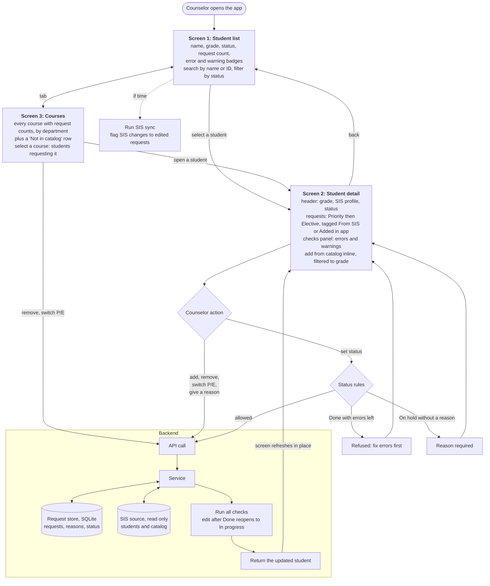

# Application flow

How the prototype's screens connect, what a counselor can do on each, and what happens behind every action. The user-side story is in [planning-meeting.md](../scenarios/planning-meeting.md); the components are in [overview.md](overview.md).

Rendered image: [img/app-flow.png](img/app-flow.png) (regenerate when the diagram below changes).

## Notes

- Three screens carry the MVP: student list, student detail, and courses ([Q12](../decisions/q012-course-view.md)). The catalog picker sits inside the detail screen so a counselor never leaves the student mid-meeting (planning-meeting.md, raised item 6).
- Every action makes one API call and gets the whole updated student back, so checks and status are always computed in one place: the backend ([overview.md](overview.md) section 7).
- Status rules: Done is refused while errors remain ([Q5](../decisions/q005-bad-sis-request-data.md)); On hold needs a reason; editing a Done student reopens it ([Q3](../decisions/q003-student-review-status.md)).
- The dashed path is the "if time" item, the SIS sync demo ([Q9](../decisions/q009-sis-sync-demo.md)). The course view replaced the tally (Q12).
