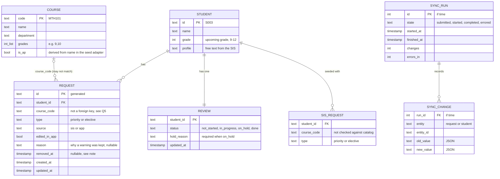

# Data schema (core build)

Covers what we will build: the student list, student detail, Courses screen and course dialog (Q1-Q5, Q11, Q12), plus the "if time" sync demo (Q9, Q13). Add-ons that are designed but not built (Q15-Q17) are listed at the end with the field each would add. This is a spec for review, not code.




## 1. Two stores, split by who owns the data

| Store | Holds | Owner | Prototype | Production |
| --- | --- | --- | --- | --- |
| `SisSource` (read-only) | Student, Course, SIS request | SIS | Seed data in code, from the exercise appendix | SIS API or file, via sync |
| `RequestStore` (read/write) | Request, Review (+ sync runs if time) | App | SQLite file, built-in `sqlite3`, plain SQL (Q8) | MongoDB at Timely |

The app never writes to Student or Course. That's the non-negotiable, and it holds because those entities have no write path at all.

## 2. SIS-owned entities (read-only)

| Entity | Field | Type | Notes |
| --- | --- | --- | --- |
| Student | `id` | text, PK | SIS ID, e.g. `S003` |
| | `name` | text | |
| | `grade` | int | The **upcoming** grade (overview §2) |
| | `profile` | text | Shown as "From SIS profile"; short note on the student list is a trimmed version |
| Course | `code` | text, PK | e.g. `MTH101` |
| | `name`, `department` | text | Department groups Courses and the catalog table |
| | `grades` | list of int | `9/10` in the appendix becomes `[9, 10]`; drives the out-of-grade warning and the catalog grade checkboxes |
| | `is_ap` | bool | Derived from the name in the seed adapter only (G9); drives the AP load warning |
| SIS request | `student_id`, `course_code`, `type` | text | The suggested requests from the appendix, loaded as-is with their errors (Q5). Used once, to seed `request` |

## 3. App-owned tables (SQLite)

```sql
CREATE TABLE request (
  id            TEXT PRIMARY KEY,
  student_id    TEXT NOT NULL,
  course_code   TEXT NOT NULL,            -- no FK to course: unknown codes must load (Q5)
  type          TEXT NOT NULL CHECK (type IN ('priority', 'elective')),
  source        TEXT NOT NULL CHECK (source IN ('sis', 'app')),
  edited_in_app INTEGER NOT NULL DEFAULT 0, -- Q2: a sync never overwrites an edited request
  reason        TEXT,                       -- Q1: why a warning was kept
  removed_at    TEXT,                       -- soft delete, see note
  created_at    TEXT NOT NULL,
  updated_at    TEXT NOT NULL
);
CREATE INDEX request_by_student ON request (student_id) WHERE removed_at IS NULL;
CREATE INDEX request_by_course  ON request (course_code) WHERE removed_at IS NULL;

CREATE TABLE review (
  student_id  TEXT PRIMARY KEY,
  status      TEXT NOT NULL DEFAULT 'not_started'
              CHECK (status IN ('not_started', 'in_progress', 'on_hold', 'done')),
  hold_reason TEXT,
  updated_at  TEXT NOT NULL,
  CHECK (status <> 'on_hold' OR hold_reason IS NOT NULL)   -- Q3
);
```

Choices worth reviewing:

- **No foreign key from `request.course_code` to the catalog.** Aisha's SS303 has to load so the app can flag it (Q5). The unknown-course rule catches it instead.
- **No unique constraint on (student, course).** Aisha's duplicate SS402 has to load too (Q5). The duplicate rule catches it and blocks Done.
- **Soft delete (`removed_at`) for removed requests.** If a counselor removes a SIS request and we deleted the row, the next sync would add it back. Keeping a removed marker lets a sync see "the counselor removed this" and leave it alone (Q2). It costs one `WHERE removed_at IS NULL` on reads. Removed rows also give the README a cheap answer on audit history (M7).
- **Changing type or reason sets `edited_in_app = 1`.** So does removing. Adding a course from the catalog creates a row with `source = 'app'`.
- **`reason` lives on the request**, not on a separate warning table, because warnings are computed (below) and a request has at most one reason in the designs.
- **Timestamps are ISO-8601 text**, SQLite's usual convention. IDs are generated in-process (overview §7).

## 4. Derived, never stored

| Derived | Computed from | Used by |
| --- | --- | --- |
| Issues (errors and warnings) | Student + active requests + catalog, via the pure rule functions (overview §3) | Student detail, check pills, Done gate, checks filter |
| Student list row | Student + review + request counts + issue counts | Screen 1 |
| Course counts (P, E, total) and the "Not in catalog" row | `SELECT course_code, type, COUNT(*) ... WHERE removed_at IS NULL GROUP BY course_code, type`, joined to the catalog in code | Screen 3 (Q12) |
| Course dialog list | Active requests for one course code, with student names | Course dialog |
| Review status after an edit | Q3 rule: editing a Done student sets `in_progress` | Every write |

Storing none of these means no stale state: every read reflects the latest edit.

## 5. Seed and reset

On first run, or on reset, the app deletes the SQLite file, then creates one `request` per SIS request (`source = 'sis'`, `edited_in_app = 0`) and one `review` per student (`not_started`). Tests do the same against an in-memory database (Q8). The design boards show a mid-season state (some edits, Done and On hold students); a "demo state" seed for the video is a possible extra, not part of this schema.

## 6. If time: sync demo (Q9, Q13)

Only if the counselor flow is done first.

```sql
CREATE TABLE sync_run (
  id          INTEGER PRIMARY KEY,
  state       TEXT NOT NULL CHECK (state IN ('submitted', 'started', 'completed', 'errored')),
  started_at  TEXT, finished_at TEXT,
  changes     INTEGER NOT NULL DEFAULT 0,
  errors_in   INTEGER NOT NULL DEFAULT 0
);
CREATE TABLE sync_change (
  run_id    INTEGER NOT NULL REFERENCES sync_run (id),
  entity    TEXT NOT NULL,            -- 'request' or 'student'
  entity_id TEXT NOT NULL,
  old_value TEXT,                     -- JSON; NULL when the change was an insert
  new_value TEXT                      -- JSON; NULL when the change was a delete
);
```

A run applies its changes in one transaction, so an errored run writes nothing. Rollback replays `old_value` for the run's changes and skips any request with `edited_in_app = 1` (Q13). In the prototype, a "sync" would read a second seed file standing in for the SIS's next export.

## 7. Not in this schema: add-ons (designed, not built)

| Add-on | What it would add | Decision |
| --- | --- | --- |
| Alternates | `request.alternate_for` (request id) and `request.rank` | Q16 |
| Graduation progress | Read-only `transcript_entry` from the SIS; app-owned `graduation_rule` per district | Q15 |
| Students not in SIS yet | App-owned `provisional_student`, plus `request.student_id` able to point at it until matched | Q17 |
| Did you mean | Nothing stored; computed from codes and profile text | Q5 D |
| Production | `school_id` / `district_id` on every table (tenancy), `edited_by` on requests (audit), counselor assignment from the SIS (G11) | overview §5 |
