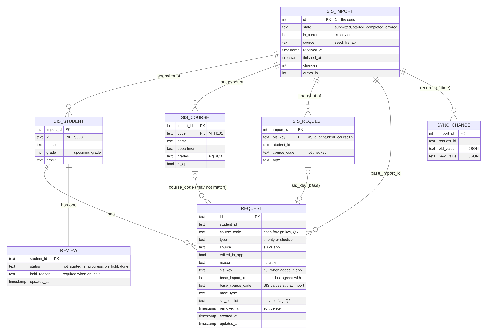
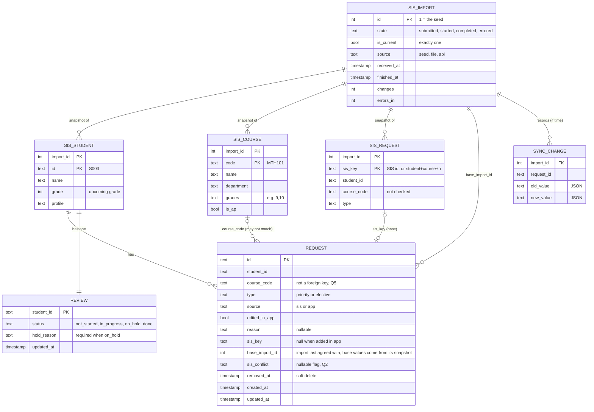

# Data schema (core build)

Covers what we will build: the student list, student detail, Courses screen and course dialog (Q1-Q5, Q11, Q12), plus SIS import versioning (Q18) and the "if time" sync demo (Q9, Q13). Add-ons that are designed but not built (Q15-Q17) are listed at the end with the field each would add. This is a spec for review, not code.





## 1. Two kinds of data, split by who owns it

| Data | Holds | Owner | Prototype | Production |
| --- | --- | --- | --- | --- |
| SIS snapshots, read via `SisSource` | `sis_import`, `sis_student`, `sis_course`, `sis_request` | SIS | SQLite; the seed loads as import #1 | Same shape, filled by the sync job (Q14) |
| App data, via `RequestStore` | `request`, `review` (+ `sync_change` if time) | App | SQLite file, built-in `sqlite3`, plain SQL (Q8) | MongoDB at Timely |

The app never writes to SIS snapshots from a user action. Only an import writes them, and an import never edits an older snapshot ([Q18](../decisions/q018-sis-import-versioning.md)). `SisSource` reads the current import, so the rest of the app doesn't know versions exist.

## 2. SIS snapshots (read-only, one set per import)

```sql
CREATE TABLE sis_import (
  id          INTEGER PRIMARY KEY,
  state       TEXT NOT NULL CHECK (state IN ('submitted', 'started', 'completed', 'errored')),
  is_current  INTEGER NOT NULL DEFAULT 0,
  source      TEXT NOT NULL,                    -- 'seed' in the prototype
  received_at TEXT NOT NULL,
  finished_at TEXT,
  changes     INTEGER NOT NULL DEFAULT 0,
  errors_in   INTEGER NOT NULL DEFAULT 0
);
CREATE UNIQUE INDEX one_current_import ON sis_import (is_current) WHERE is_current = 1;

CREATE TABLE sis_student (
  import_id INTEGER NOT NULL REFERENCES sis_import (id),
  id        TEXT NOT NULL,          -- SIS ID, e.g. S003
  name      TEXT NOT NULL,
  grade     INTEGER NOT NULL,       -- the upcoming grade (overview §2)
  profile   TEXT,
  PRIMARY KEY (import_id, id)
);

CREATE TABLE sis_course (
  import_id  INTEGER NOT NULL REFERENCES sis_import (id),
  code       TEXT NOT NULL,         -- e.g. MTH101
  name       TEXT NOT NULL,
  department TEXT NOT NULL,
  grades     TEXT NOT NULL,         -- '9,10'; appendix '9/10'
  is_ap      INTEGER NOT NULL,      -- derived from the name in the seed adapter only (G9)
  PRIMARY KEY (import_id, code)
);

CREATE TABLE sis_request (
  import_id   INTEGER NOT NULL REFERENCES sis_import (id),
  sis_key     TEXT NOT NULL,        -- the SIS's request ID; in the seed, student|course|n, e.g. 'S008|SS402|2'
  student_id  TEXT NOT NULL,
  course_code TEXT NOT NULL,        -- loaded as-is with errors (Q5)
  type        TEXT NOT NULL CHECK (type IN ('priority', 'elective')),
  PRIMARY KEY (import_id, sis_key)
);
```

- **An import is a Q13 sync run.** The table replaces the earlier `sync_run`. Its states are Timely's job states (Q13, Q14).
- **One row per student per import is history, not duplicates.** The app reads only the current import; requests and reviews key on the SIS student ID, never on an import's copy. Storage grows as students × imports (about 730,000 rows a year for 2,000 students synced nightly). At scale, store a new row only when a record changes, with valid-from and valid-to import IDs; the prototype keeps full snapshots.
- **An errored import is never marked current**, so a failed run changes nothing anyone sees.
- **The sis_key is student + course + an occurrence counter** when the SIS sends no request ID. Type is not part of the key, so a SIS change from priority to elective is a type change on the same request. The counter (`1`, `2`) only separates duplicates like Aisha's two SS402 rows, which are already errors (Q5); if the SIS reorders duplicates, they may swap keys, which is acceptable for rows that block Done anyway.
- **`sis_import.id` is the internal version ID.** Every request records the import it last agreed with (`base_import_id`).

## 3. App-owned tables

```sql
CREATE TABLE request (
  id               TEXT PRIMARY KEY,
  student_id       TEXT NOT NULL,
  course_code      TEXT NOT NULL,     -- no FK to the catalog: unknown codes must load (Q5)
  type             TEXT NOT NULL CHECK (type IN ('priority', 'elective')),
  source           TEXT NOT NULL CHECK (source IN ('sis', 'app')),
  edited_in_app    INTEGER NOT NULL DEFAULT 0,   -- Q2
  reason           TEXT,                         -- Q1: why a warning was kept
  -- Q18: the SIS base this request last agreed with (all NULL when added in the app)
  sis_key          TEXT,
  base_import_id   INTEGER REFERENCES sis_import (id),  -- base values = sis_request at (base_import_id, sis_key)
  sis_conflict     TEXT,                         -- set by a reconcile when both sides changed (Q2)
  removed_at       TEXT,                         -- soft delete, see below
  created_at       TEXT NOT NULL,
  updated_at       TEXT NOT NULL
);
CREATE INDEX request_by_student ON request (student_id) WHERE removed_at IS NULL;
CREATE INDEX request_by_course  ON request (course_code) WHERE removed_at IS NULL;

CREATE TABLE review (
  student_id  TEXT PRIMARY KEY,
  status      TEXT NOT NULL DEFAULT 'not_started'
              CHECK (status IN ('not_started', 'in_progress', 'on_hold', 'done')),
  hold_reason TEXT,
  updated_at  TEXT NOT NULL,
  CHECK (status <> 'on_hold' OR hold_reason IS NOT NULL)   -- Q3
);

-- Q20: a row only for a check someone switched off or back on; no row means on
CREATE TABLE check_setting (
  rule       TEXT PRIMARY KEY,   -- a rule id from app/rules.py, e.g. 'core_subject'
  enabled    INTEGER NOT NULL,
  updated_at TEXT NOT NULL
);
```

Choices worth reviewing:

- **No foreign key from `request.course_code` to the catalog.** Aisha's SS303 has to load so the app can flag it (Q5). The unknown-course rule catches it instead.
- **No unique constraint on (student, course).** Aisha's duplicate SS402 has to load too (Q5). The duplicate rule catches it and blocks Done.
- **`sis_key` + `base_import_id` make the three-way compare possible** (Q18): the base values are read from that import's snapshot, not copied onto the request. "Did the SIS change this, or did the counselor?" is answered by comparing base vs new SIS, and base vs the app's current values. `edited_in_app` stays as the quick flag the UI and rollback use.
- **Soft delete (`removed_at`).** If a counselor removes a SIS request and we deleted the row, the next import would add it back. The removed row, with its `sis_key`, tells a reconcile "the counselor removed this" (Q2). It costs one `WHERE removed_at IS NULL` on reads, and gives the README a cheap answer on audit history (M7).
- **Changing type or reason, or removing, sets `edited_in_app = 1`.** Adding from the catalog creates a row with `source = 'app'` and no `sis_key`.
- **`reason` lives on the request**, because warnings are computed (below) and a request has at most one reason in the designs.
- **Timestamps are ISO-8601 text**, SQLite's usual convention. IDs are generated in-process (overview §7).

## 4. Derived, never stored

| Derived | Computed from | Used by |
| --- | --- | --- |
| Issues (errors and warnings) | Current-import student and catalog + active requests, via the switched-on rule functions (overview §3, Q20) | Student detail, check pills, Done gate, checks filter |
| Student list row | Student + review + request counts + issue counts | Screen 1 |
| Course counts (P, E, total) and the "Not in catalog" row | Active requests grouped by course and type, joined to the current catalog in code | Screen 3 (Q12) |
| Course dialog list | Active requests for one course code, with student names | Course dialog |
| Review status after an edit | Q3 rule: editing a Done student sets `in_progress` | Every write |
| "SIS data as of" in the header | `received_at` of the current import | Every screen |

Storing none of these means no stale state: every read reflects the latest edit and the current import.

## 5. Seed and reset

On first run, or on reset, the app deletes the SQLite file and loads the appendix as **import #1** (`source = 'seed'`, completed, current). It then creates one `request` per SIS request (`source = 'sis'`, `edited_in_app = 0`, `sis_key` and base fields set from import #1) and one `review` per student (`not_started`). Tests do the same against an in-memory database (Q8).

## 6. If time: reconcile a second import (Q9, Q13, Q18)

Built only if the counselor flow is done first. A second seed file stands in for the SIS's next export and loads as import #2:

1. Diff import #1 and #2 by `sis_key` (DuckDB, Q7).
2. For each request, compare base, app and new SIS: apply SIS-only changes, keep app-only changes, set `sis_conflict` when both changed, add new SIS requests, remove gone ones if untouched or flag them if edited.
3. Write one `sync_change` row per request touched, then mark #2 current, all in one transaction. An error leaves #1 current and writes nothing.
4. Rollback: point `is_current` back at #1 and replay `old_value` for the run's changes, skipping requests edited since (Q13).

```sql
CREATE TABLE sync_change (
  import_id  INTEGER NOT NULL REFERENCES sis_import (id),
  request_id TEXT NOT NULL,
  old_value  TEXT,          -- JSON; NULL when the change was an insert
  new_value  TEXT           -- JSON; NULL when the change was a removal
);
```

Retention: keep the last N imports (N to set with Stephen; trivial at 10 students), and never prune an import that an active request still names as its `base_import_id`.

## 7. Not in this schema: add-ons (designed, not built)

| Add-on | What it would add | Decision |
| --- | --- | --- |
| Alternates | `request.alternate_for` (request id) and `request.rank` | Q16 |
| Graduation progress | Read-only `transcript_entry` from the SIS; app-owned `graduation_rule` per district | Q15 |
| Students not in SIS yet | App-owned `provisional_student`, plus `request.student_id` able to point at it until matched | Q17 |
| Did you mean | Nothing stored; computed from codes and profile text | Q5 D |
| Production | `school_id` / `district_id` on every table (tenancy), `edited_by` on requests (audit), counselor assignment from the SIS (G11) | overview §5 |
