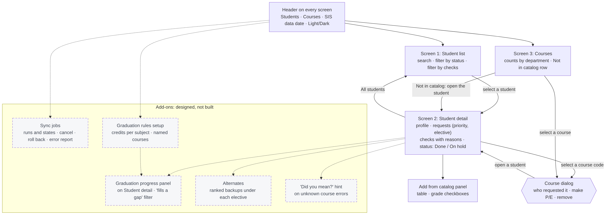
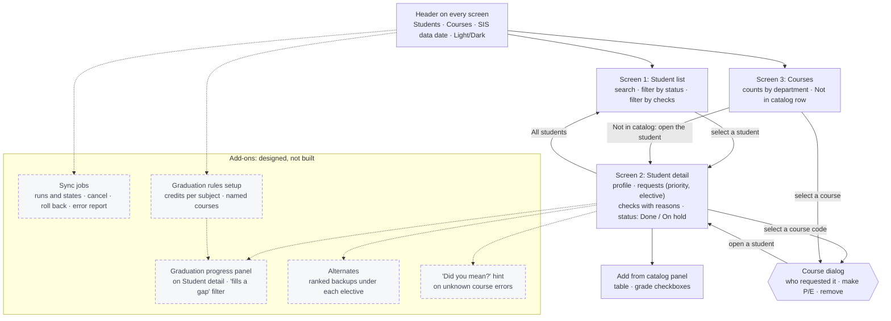

# Site map

Solid boxes are in the core build. Dashed boxes are add-ons that are designed but not built (Q5 option D, Q14, Q15, Q16). Every screen shares one header: Students, Courses, the SIS data date, the signed-in name and the light/dark toggle.

| Screen or dialog | Reached from | Decisions |
| --- | --- | --- |
| Student list | Header, "All students" | Q3, Q5 |
| Student detail | Student list; course dialog; Not in catalog row | Q1-Q5, Q11 |
| Courses | Header | Q12 |
| Course dialog | Courses; any course code on a student page | Q12 |
| Sync jobs (add-on) | Header, for an admin | Q13, Q14 |
| Graduation rules setup (add-on) | Header, for a district admin | Q15 |
| Graduation progress, Alternates, Did you mean (add-ons) | Inside Student detail | Q15, Q16, Q5 D |
