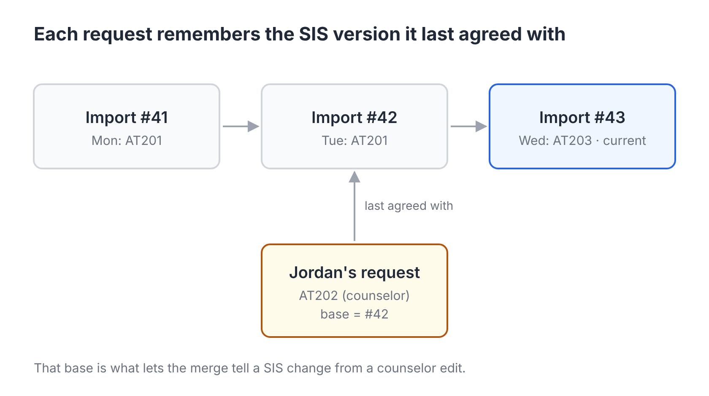
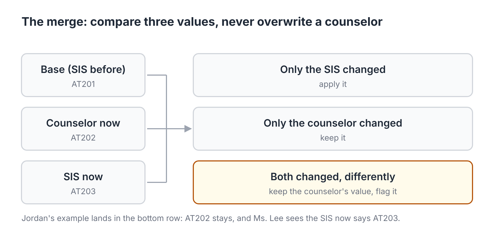

# Reconciliation deep dive

The rules are in [SIS sync design §3.6](../sis-sync-design.md#36-the-three-way-merge). This page covers where those rules get hard, what I'd do about each case, and how I'd show the merge is correct. It's prep for the next round, so where I'm proposing something new rather than restating a logged decision, I say so.

## The problem

Two writers change the same course request. The SIS changes it overnight, and a counselor can change it at any time. Neither one is always right. The sync has to apply what the SIS really changed, keep what the counselor did, and flag the cases where both changed the same thing. It must never lose counselor work, and it shouldn't bury counselors in flags.

Comparing the SIS to the app can't do this. If the SIS says AT201 and the app says AT202, you can't tell whether the counselor changed it or the SIS fixed a mistake. You need a third value: what the SIS said the last time the two agreed. That's why every request keeps `base_import_id`, and why imports are never edited ([Q18](../decisions/q018-sis-import-versioning.md)).

## Five places it gets hard

### 1. Identity: which row is which

The merge pairs each new SIS row with an old one by `sis_key`. If the pairing is wrong, everything after it is wrong too.

- **With a SIS request ID** (we assume PowerSchool sends one, RQ2), pairing is exact. A course change is a change to one request.
- **Without one**, the key is student + course + a counter. A course change in the SIS then looks like one request removed and another added. If the counselor had edited the old request, they now see a flagged "removed" request next to a new one. Nothing is lost, but it's confusing.
- **What I'd add (proposal):** when one run removes a request and adds another for the same student, link the two in the flag ("the SIS may have replaced AT201 with AT203") and let the counselor decide. Never match them automatically.
- **Signal to watch (proposal):** how many requests each run removes and adds, against how many it changes. A district where most "changes" arrive as remove-plus-add probably has unstable keys. That's a mapping problem to fix at setup, not something counselors should absorb.

### 2. Granularity: whole request or field by field

I'd merge field by field. If the SIS changes a request's type from elective to priority while the counselor adds a reason, both changes apply and nothing is flagged. Only the same field changing on both sides raises a flag. Reasons and review status exist only in the app, so the SIS can never conflict with them. With the fallback key, the course code is part of the key, so in practice type is the only field that can conflict. Alternates add a rank field later ([§3.10](../sis-sync-design.md#310-designed-not-in-the-mvp-transcripts-and-alternates)).

### 3. Deletes

A counselor's removal is a soft delete, so the row stays and remembers its `sis_key` ([schema](../architecture/schema.md#3-app-owned-tables)). Without that, the next import would just add the request back.

| SIS | Counselor | Result |
| --- | --- | --- |
| Still sends it, unchanged | Removed it | It stays removed |
| Changed it | Removed it | It stays removed, flagged: "the SIS updated a request you removed" |
| Removed it | Removed it | They agree, nothing to do |
| Removed it | Edited it | It stays, flagged (already in §3.6) |

The first row is the one that matters most. Without soft deletes, counselors would remove the same SIS request every morning.

### 4. Timing: syncs, edits and restores at the same moment

- **Runs are serial per district.** Only one sync runs for a district at a time ([§3.9](../sis-sync-design.md#39-limits-monitoring-and-errors)), so two merges never race each other.
- **A counselor saving during a merge (proposal):** the merge applies in one transaction and checks each request's `updated_at` before it writes. If a counselor saved in the meantime, the merge doesn't overwrite it. That request keeps its old base, and the next run compares it again. The counselor's save always wins, and the cost is one day's delay for that request.
- **Restores:** a restore undoes runs newest first and skips any request a counselor edited after that run ([Q24](../decisions/q024-restore-to-kept-import.md)), so bases stay consistent.
- **Write-back** makes conflicts rarer, but it doesn't remove the need for the merge, because the SIS can change between a write-back and the next import ([Q19](../decisions/q019-one-way-sync-baseline.md)).

### 5. Changes the merge doesn't see

Students and courses aren't merged. A new import just replaces them, and the checks run again on every read ([§3.6](../sis-sync-design.md#36-the-three-way-merge)). Moving a student up a grade or dropping a course can turn a finished plan into one with errors, and no counselor touched it.

**Open question:** should a sync that adds errors to a Done student reopen them? Today only a counselor's edit reopens a Done student ([Q3](../decisions/q003-student-review-status.md)). My leaning is to keep the status, show the student under "need attention", and say why: the SIS changed. A sync shouldn't quietly undo a counselor's sign-off, but it also shouldn't hide a new error.

## Keeping flags rare

Every flag costs a counselor time. So I'd measure the flags, not just the sync:

- **Flags raised per run, per district.** A sudden jump means a bad export or a mapping change, and it feeds the "far above normal" alert ([Q25](../decisions/q025-abnormal-runs-apply-and-alert.md)).
- **How flags get resolved:** keep mine or take the SIS's value. If counselors nearly always take the SIS's value, the SIS is fixing real mistakes, and write-back (or an earlier sync) would prevent the flags.
- **The flag itself** shows all three values (before, the counselor's, the SIS's now) and two buttons. Either button moves the base to the current import, so the same difference never comes back.

I have no numbers for any of these yet. Setting thresholds is a pilot task.

## How I'd show it works

1. **Every row of the §3.6 table is a test case**, plus the delete table above. They're small enough to read in a review.
2. **Property tests** generate random sequences of imports and counselor edits, then check the invariants after each step:
   - A counselor's value is never overwritten.
   - Requests added in the app are never touched.
   - Merging the same import twice changes nothing ([Q27](../decisions/q027-zero-change-imports.md)).
   - Restoring to import N leaves SIS-owned values the same as they were at N.
3. **Replay before release.** Every raw export is kept in S3 ([§3.4](../sis-sync-design.md#34-versioned-sis-data-telling-one-import-from-the-next)). Before a merge change ships, replay a pilot district's season through the old and new code in a dry run, and diff the results. Any difference has to be one we meant.

The prototype has the schema for all of this. The merge itself is issue #12 and isn't built yet.

## What I'd ask Timely

- When a registrar changes a request's course in PowerSchool, is that the same record, or a delete and a new insert? This decides whether problem 1 above is a real problem.
- During request season, how often do registrars change requests that counselors have already worked on? This sets how many flags to expect.
- Who should resolve a flag: the counselor, or the registrar who made the SIS change?
- Is there a date when requests lock for the optimizer? After it, SIS changes could go to a registrar queue instead of being merged into the requests.

## What I'd leave out

No automatic conflict resolution beyond the table: no "latest edit wins", and no field-level timestamps from the SIS that we can't trust. A flag that a person resolves in two clicks is cheaper than a wrong automatic decision during a planning meeting.
