# Scenario: planning meeting with a student

Draft for brainstorming with Stephen. Each step names what the counselor needs, what the app shows, and which decision it rests on. **Open** marks something the scenario raises that isn't decided yet.

**Setting:** Ms. Lee, a counselor, has a 20-minute meeting with Jordan Williams (S003, going into grade 10). Jordan failed Algebra I last year. The SIS already sent a draft request list. Jordan is sitting next to her, looking at the same screen.

## The flow

Rendered image: [img/planning-meeting-flow.png](img/planning-meeting-flow.png) (regenerate when the diagram below changes).

```mermaid
flowchart TD
    A([Ms. Lee opens the app]) --> B[Student list<br/>her caseload, filtered to Not started]
    B --> C{Find Jordan}
    C -->|types 'jor'| D[Search by name or ID]
    C -->|scrolls| E[List shows grade, status,<br/>request count, error/warning badges]
    D --> F
    E --> F

    F[Student detail: Jordan Williams, grade 10] --> G

    subgraph REVIEW [Step 1: Where is Jordan now?]
        G[Profile from the SIS<br/>'Failed MTH101, must retake'] --> H[Draft requests from the SIS<br/>each tagged 'From SIS']
        H --> I[Check panel<br/>warning: MTH101 is a grade 9 course]
    end

    I --> J

    subgraph NEEDS [Step 2: What does Jordan need next year?]
        J{Core subjects covered?<br/>Math, English, Soc. Studies, Science} -->|yes| K[Keep MTH101 as Priority<br/>reason: 'retake' clears the warning]
        J -->|missing one| L[Warning: no priority Science<br/>add from catalog]
        L --> K
    end

    K --> M

    subgraph PREFS [Step 3: What does Jordan want?]
        M{Did Jordan pick<br/>electives beforehand?}
        M -->|yes: picks came in<br/>through the SIS| M1[Review his picks<br/>tagged 'From SIS']
        M1 --> M2{Keep each pick?}
        M2 -->|keep| P
        M2 -->|change| N
        M -->|no: choose together| N[Browse catalog<br/>filtered to grade 10, 'show all' toggle]
        N --> O[Swap elective AT201 Web Design<br/>for AT202 Music Theory]
        O --> P[Final electives<br/>new ones tagged 'Added in app']
    end

    P --> Q

    subgraph WRAP [Step 4: Wrap up]
        Q[Summary: 4 Priority, 1 Elective<br/>grouped, with reasons] --> R{Any errors left?}
        R -->|no| S[Mark Done]
        R -->|yes| T[Done is blocked<br/>fix or mark On hold with a reason]
        T --> U[On hold: 'waiting on transcript']
    end

    S --> V([Back to the list: next student])
    U --> V
```

## Step by step

| Step | Counselor needs | App shows | Rests on |
| --- | --- | --- | --- |
| Open the app | To see her students, not the whole school | Student list | **Open:** caseloads (gaps.md G11) |
| Find the student | To get to Jordan in seconds, with him sitting there | Search by name or ID; status filter | R1, [Q3](../decisions/q003-student-review-status.md) |
| Review where he is | His situation and the SIS draft at a glance | Profile, draft requests tagged by source, check panel | [Q2](../decisions/q002-request-ownership.md), [Q5](../decisions/q005-bad-sis-request-data.md) |
| What he needs | Confidence the core is covered, and the retake handled | Core-subject check; grade warning kept with "retake" | [Q1](../decisions/q001-out-of-grade-courses.md), [Q4](../decisions/q004-priority-core-check.md) |
| What he wants | Review picks he made beforehand, or choose together, then adjust quickly while talking | His SIS-sourced picks; catalog filtered to his grade; add, remove, switch P/E | R3, [Q11](../decisions/q011-student-preferences.md) |
| Wrap up | To read back the plan and close it out | Summary grouped Priority then Elective; set status | R4, Q3, Q5 |

## What this scenario raises (to discuss)

1. **"Where is he now" needs history we don't have.** A real meeting starts from the transcript: credits earned, courses passed and failed. The exercise gives only a free-text profile. The prototype shows the profile; the design names transcripts as the next data to bring from the SIS (gaps.md G3).
2. **The student is looking at the screen.** Staff-only doesn't mean nobody else sees it. Are counselor reasons ("retake", "transcript pending") fine for Jordan to read? *(Inferred: yes for these, but notes on sensitive matters would need a private field.)*
3. **Preferences vs requests.** Both happen ([Q11](../decisions/q011-student-preferences.md)): some students arrive with picks made beforehand, which reach the app through the SIS; others choose with the counselor live. One screen handles both.
4. **Ranked electives and alternates.** If Music Theory is full, what's Jordan's second choice? Real request processes collect alternates (gaps.md G8; out of MVP per [Q6](../decisions/q006-timebox-and-mvp-scope.md)).
5. **Leaving with something.** Does Jordan (or his parents) get a copy of the plan? Printing a summary is cheap; a parent portal is out of scope.
6. **Meeting speed.** With a student waiting, every action must be one or two clicks and never reload the page. That argues for adding courses inline on the detail screen rather than a separate catalog page.

## Other scenarios to brainstorm next

| # | Scenario | Who | Why it matters |
| --- | --- | --- | --- |
| S2 | **Working the caseload alone:** no student present; clear every "Not started" student before the deadline, fixing SIS errors (Aisha) and parking cases (Nina) | Counselor | The work-queue use of status and errors; likely most of a counselor's time |
| S3 | **Oversight:** an assistant principal checks who isn't finished and reviews unusual choices (Sofia's grade 12 APs, with reasons) | AP | Why reasons and the status filter exist |
| S4 | **The morning after a sync:** the SIS changed overnight; what does the counselor see? | Counselor | Q2's flag in practice; the sync demo ([Q9](../decisions/q009-sis-sync-demo.md)) |
| S5 | **Transfer student:** Nina arrives with placeholder requests and no transcript | Counselor | On hold with a reason; what "done" means for her |
