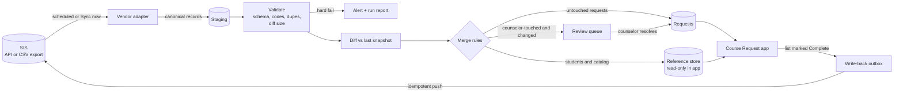
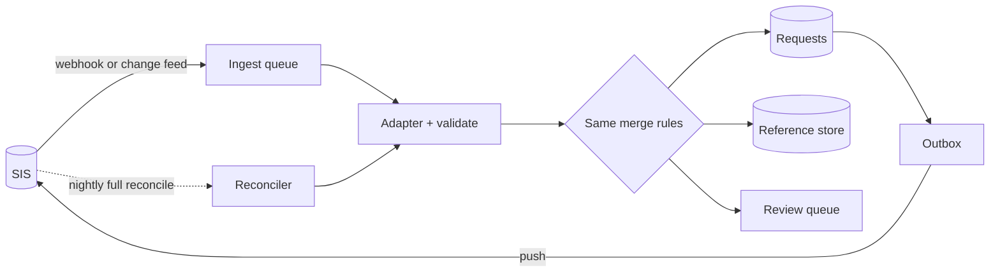

# SIS data sync: design proposal

**Status:** Draft for async review by engineering and product. Discussion to follow.
**Author:** Stephen Mayer

## TL;DR

- **Pull students and the catalog from the SIS on a schedule into a local copy.** The app reads only
  from that copy, never from the SIS live. SIS outages and rate limits then never take the app down
  in request season.
- **Treat course requests as a merge, not a copy.** Every request carries provenance (who created
  it and whether a counselor has touched it). SIS changes apply automatically to untouched requests.
  If a counselor has edited a request, the SIS change goes to a review queue instead of
  overwriting their work.
- **Stage, validate, and diff every import before applying it.** Bad SIS data (unknown course
  codes, duplicates, missing students) gets caught and shown instead of silently corrupting
  counselor work. The sample data already contains both kinds of error.
- **Write requests back to the SIS only when the list is finalized**, as an explicit, auditable
  step, not continuously.
- **Start with batch snapshot sync (Approach A)** for the pilot. Move to incremental sync (Approach
  B) per vendor once volume or freshness needs justify it.

## Context

| Data | Owner | In the app |
| --- | --- | --- |
| Students | SIS | Read-only |
| Course catalog | SIS | Read-only |
| Course requests | Shared | May arrive from the SIS; counselors create and edit them in the app |

The hard part is the third row. Students and courses flow one way. Requests have two writers, and
the design has to say who wins, when, and how anyone finds out.

## 1. Requirements to understand first

| Question | Why it matters |
| --- | --- |
| **Which SIS vendors, and through what interface?** (PowerSchool, Infinite Campus, Skyward, Aeries, Synergy; REST API, OneRoster, or CSV/SFTP exports) | Sets what "sync" can mean. Some offer change feeds, some only full exports, and some schools can only upload files. This decides whether incremental sync is even possible. |
| **Does the SIS hold course requests at all, and who enters them there?** | If counselors or students also enter requests in the SIS during the same window, we have real two-writer conflicts. If the SIS only holds last year's or imported requests, a one-time seed is enough. |
| **Do we write requests back to the SIS? When, and who triggers it?** | Write-back needs vendor write access, district approval, and idempotency. Timing (continuous versus on finalize) sets the conflict model. |
| **How fresh does the data need to be?** | A student who enrolls today must show up for counselors. Is that same-day, within the hour, or immediately? Nightly batch is far simpler than near-real-time. |
| **Volume and cadence.** Students per school and district, catalog size, how many changes per day during request season (Jan to Mar) | Drives full-snapshot versus incremental sync, and API rate-limit budgets. |
| **Identity.** Stable student and course IDs? Do course codes change year to year? | Matching on a code that gets reused or renumbered quietly attaches requests to the wrong course. We need SIS-native IDs and a mapping table. |
| **Lifecycle events.** Withdrawals, transfers in, grade changes, retired courses, school-year rollover | Each one changes what should happen to existing requests: archive, flag, or carry forward. |
| **Data quality today.** How often does SIS data have bad codes, duplicates, or missing fields? | The sample data has both a bad code and a duplicate. Validation and a human review step aren't optional. |
| **Security and compliance.** FERPA, district data agreements, SOC 2 scope, credential storage | Determines where credentials live, what we log, and how long we retain raw payloads. |
| **Who handles sync failures?** School staff, School Success, or the integrations team in India during the season | The review queue and alerts need a clear owner, or they become noise. |

## 2. Key decisions

### D1. Sync direction for requests

| Option | Trade-off |
| --- | --- |
| a. Read-only import; app is the source of truth after import | Simplest. Breaks if the SIS keeps receiving request edits. |
| b. Import, then **write back on finalize** | Clear ownership window. One explicit push per student list. |
| c. Full two-way continuous sync | Freshest, but the most conflict surface and vendor-specific failure modes. |

**Recommendation: b.** The app owns requests during request season, and finalized lists are pushed
back. Revisit c only if pilot schools truly edit requests in both places at once.

### D2. Conflict handling when the SIS changes a request

| Option | Trade-off |
| --- | --- |
| a. SIS always wins | Silently destroys counselor work. Not acceptable. |
| b. App always wins | Ignores legitimate SIS corrections, such as a student withdrawing. |
| c. **Provenance-based merge** | Untouched requests (`source=sis`, never edited) follow the SIS. Counselor-touched requests are protected, and differing SIS changes go to a review queue. |

**Recommendation: c.** The prototype already stores `source`, `sis_id`, `updated_by`, and
`updated_at` on every request, which is exactly what this needs. A per-field `last_synced_value`
lets us tell "SIS changed it" apart from "counselor changed it".

### D3. Sync trigger and cadence

| Option | Trade-off |
| --- | --- |
| a. **Scheduled batch** (nightly, or hourly in season) **plus an on-demand "Sync now"** | Predictable load, easy to retry, works with every vendor including file uploads. |
| b. Webhooks or change feeds | Freshest, but not every vendor offers them, and missed events need a backstop anyway. |
| c. Live reads from the SIS | Simplest code, but couples app uptime and latency to the SIS. Not acceptable. |

**Recommendation: a**, with b added per vendor later. A scheduled full reconcile stays as the
backstop even after b exists.

### D4. Validation gate before data goes live

| Option | Trade-off |
| --- | --- |
| a. Apply imports directly | Bad data reaches counselors immediately. |
| b. **Stage, validate, diff, then apply** | Catches unknown codes, duplicates, and suspicious mass changes (for example, 40% of students disappearing). Adds one step. |

**Recommendation: b.** Hard failures, such as a schema mismatch or an implausible diff size, stop
the run and alert. Soft failures, such as one unknown code, apply with the issue attached to the
record, which is what the prototype shows for S008.

### D5. Identity and mapping

**Recommendation:** key everything on the SIS's stable internal IDs (`sis_student_id`,
`sis_course_id`), never on display codes alone. Keep a mapping table per tenant, plus a
year-scoped catalog, so a renumbered course doesn't orphan requests.

### D6. Deletes and lifecycle

| Event | Recommendation |
| --- | --- |
| Student withdraws (missing from the SIS) | Soft-delete the student and archive their requests. Never hard-delete, because they may re-enroll. |
| Course retired from the catalog | Keep existing requests, flag them as an error ("course no longer offered"), and let the counselor replace them. |
| Grade change | Re-run checks. Grade-eligibility warnings appear automatically. |
| School-year rollover | A new year-scoped catalog and request set. The previous year stays read-only for reference. |

### D7. Vendor abstraction

**Recommendation:** one adapter per vendor that maps into a single **canonical model**
(OneRoster-shaped where possible). Validation, diffing, merge, and the app never see vendor
formats. A CSV upload adapter ships first, since it works for any school and doubles as the
fallback when an API integration breaks.

## 3. Flow and architecture

### Approach A: batch snapshot sync (recommended for the pilot)

1. **Extract.** The adapter pulls a full snapshot for one school and year and maps it to canonical
   records.
2. **Stage and validate.** Records land in a staging area tagged with a `sync_run_id`. Hard
   failures stop the run.
3. **Diff.** Compare against the last applied snapshot to get inserts, updates, and deletes.
4. **Merge.** Students and the catalog apply directly. Requests follow D2: untouched ones update,
   counselor-touched ones go to the review queue when the SIS differs.
5. **Write back.** When a counselor marks a list Complete, an outbox record is created and a worker
   pushes it to the SIS, keyed by request ID so retries are safe.
6. **Observe.** Each run produces a report: counts, issues, conflicts, duration. School Success can
   read it without engineering.

**Fits when:** vendor APIs are limited or file-based, freshness within an hour is fine, and volume
per school is modest. These are typical K-12 conditions.

### Approach B: incremental, event-driven sync (later, per vendor)

The adapters, canonical model, merge rules, and outbox are the same as in A. Only the trigger
changes, with per-record events instead of snapshots. A nightly reconcile stays in place to catch
missed events.

**Fits when:** a vendor offers reliable change feeds, and a school needs near-real-time data, such
as heavy mid-season enrollment churn.

### How the choice depends on the assumptions

| If we learn... | Then... |
| --- | --- |
| The SIS never holds requests in season | Drop the review queue for requests and keep a one-time import. |
| Counselors also edit requests in the SIS during the season | D1 moves toward c, and the review queue becomes a core screen, not an edge case. |
| Same-day freshness is enough | Approach A only, with no need for B. |
| A pilot vendor only supports CSV | Approach A with the CSV adapter. This changes nothing downstream. |
| Write-back isn't allowed | Replace the outbox with an export file the school uploads. Same finalize step. |

## Risks and open questions

- **Mass-change safety.** A bad export can look like "every student withdrew." The diff-size
  check (D4) is the guard. What threshold should trigger a hold?
- **Review queue volume in peak season.** If conflicts are common, the queue becomes a chore.
  We'll measure it in the pilot before building more UI.
- **Write-back failures** after a counselor thinks they're done. The status should show "Complete,
  pending sync" until the SIS confirms.
- **Where the LLM fits.** Suggesting fixes for bad SIS data, like the prototype's "Did you mean
  SS403?", is a good fit for a model with a human approving. Deciding merges is not. Merges stay
  deterministic and auditable.

## How this maps to the prototype

- `ReferenceData` is the read-only reference store. `RequestRepository` holds the requests.
- `CourseRequest.source`, `sis_id`, `updated_by`, and `updated_at` are the provenance fields D2 relies on.
- `rules.py` is where soft validation failures surface to counselors.
- Marking a list **Complete** is the natural trigger for write-back.
