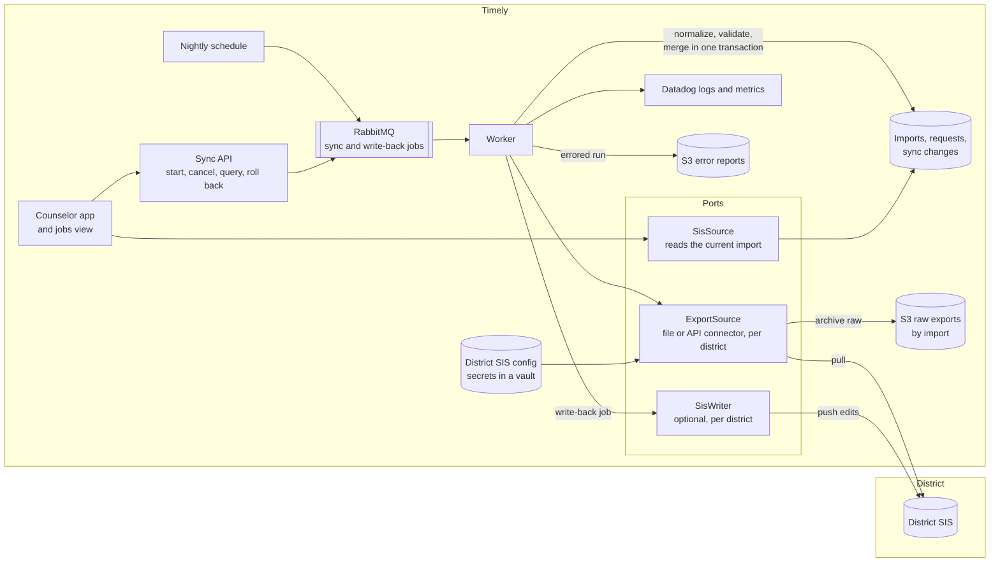
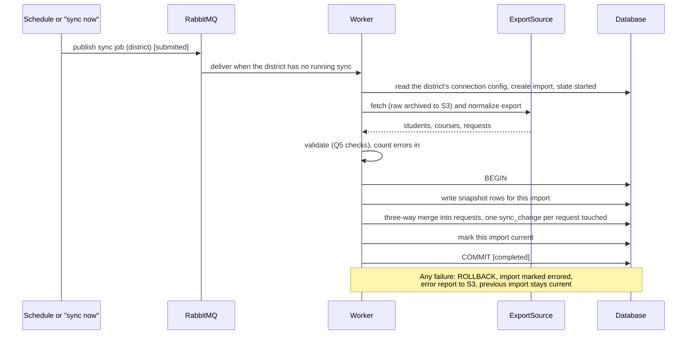

# SIS sync design

For an engineering team and a product partner to read before we discuss it. Product readers: sections 1, 2 and 5. Engineers: all of it, especially 3 and 4. Every decision links to its record in [`decisions/`](decisions/README.md), where the options and trade-offs are written out in full; this doc says how they fit together.

**The problem in one paragraph.** Students and the course catalog belong to the district's SIS and are read-only in the app. Course requests can arrive from the SIS, and counselors then edit them in the app. The sync has to keep SIS data current every day without losing counselor work, let bad data in without breaking anything (and show it), recover from a bad sync without an approval step, and run for many districts whose SIS platforms differ in what they send, what they accept and how fast they let us call them.

**The design in one paragraph.** Each sync is a job on Timely's existing queue, with Timely's job states. A per-district connector fetches the SIS export (a file or an API) and normalizes it into an immutable, versioned **import**. The app merges each new import into its own requests **three ways** (what the SIS said last time, what the app has now, what the SIS says now): SIS-only changes apply, counselor-only changes stay, and when both changed the counselor gets a flag and nothing is overwritten. An import applies in one transaction or not at all, and a completed one can be rolled back in one action. Where a district's SIS accepts writes, counselor edits go back as a separate job, which makes conflicts rare but never replaces the merge.

## 1. Requirements: what we need to know before committing

These are questions, not answers. Each one changes the design, so each says what it changes. The first six come first because they change the most.

| # | Question | Why it matters | What we assume until answered |
| --- | --- | --- | --- |
| RQ1 | Does the district's SIS accept writes to course requests, and for which fields? | Sets how many conflicts counselors see. With write-back, the next import already agrees with the counselor. ([Q19](decisions/q019-one-way-sync-baseline.md), [gaps.md](requirements/gaps.md) G24) | No. One-way sync everywhere; write-back is an optional per-district job. |
| RQ2 | Does the SIS send its own stable ID for each course request? | The merge needs to know which old row a new row is. With an ID, matching is exact. Without one, we key on student + course + an occurrence counter, which can't follow a course change. ([Q18](decisions/q018-sis-import-versioning.md)) | No ID. The fallback key is used, and a course change in the SIS reads as one removal plus one addition. |
| RQ3 | What are the SIS API's rate limits, per district and per vendor? Is there a file export instead? | Sets how often we can sync, how long a full pull takes, and whether the queue must throttle per district. ([interview-feedback.md](requirements/interview-feedback.md) F8) | Limited per district. One running sync per district at a time; the connector throttles its own calls. |
| RQ4 | How fast do new enrollments, withdrawals and grade changes reach the SIS during request season? | Decides nightly vs on-demand sync, and how long a provisional student lives before it's matched. ([Q17](decisions/q017-provisional-students.md), gaps.md G22, G33) | Days, not minutes. Nightly sync plus an on-demand "sync now". |
| RQ5 | How dirty is the incoming data, and who fixes it today? | Decides how loud the error reporting must be, and whether a counselor or the registrar owns the fix. ([Q5](decisions/q005-bad-sis-request-data.md), gaps.md G27) | Dirty (the seed has an unknown code and a duplicate). Load as-is, flag, block Done. |
| RQ6 | Does the SIS hold transcripts (courses taken, grades, credits), and can we read them? | Unlocks graduation progress and prerequisite checks, the biggest gap in today's checks. ([Q15](decisions/q015-history-and-grad-rules.md)) | Usually yes, but not in this phase. The feed is designed as one more read-only input. |
| RQ7 | Which SIS platforms come first, and how do they deliver data (API, scheduled file export, push)? | Decides which connector we build first. (gaps.md G21) | One file-based connector first; an API connector second. |
| RQ8 | Are student IDs and course codes stable from year to year? | Every link between a request and the SIS hangs off them. (gaps.md G25) | Stable within a school year. Year rollover is out of scope for the MVP. |
| RQ9 | Does the SIS send a full export every time, or only changes since a date? | A delta feed is cheaper to pull but can silently miss rows; a full export lets us detect removals. | Full export. If only deltas exist, we run a periodic full pull to catch drift. |
| RQ10 | Does the SIS carry alternate requests ("if not this, then that") or group requests ("any one Arts & Tech elective")? | Alternates change the request shape the connector must normalize. (gaps.md G32) | Likely yes: PowerSchool tracks primary and alternate requests (3.1). The connector maps them to Q16's fields ([Q16](decisions/q016-alternate-requests.md)). |
| RQ11 | Who at the district can see sync results, and who is allowed to roll one back? | Rollback is powerful; it shouldn't be one click for every counselor. | District admins and Timely support. Roles are out of scope for the prototype (requirements M10). |
| RQ12 | Who sets up a district's SIS connection, and what does the district provide (credentials, file drop, field meanings)? | Decides whether we need a setup screen for districts or only an internal one, and how long onboarding takes. | Timely's implementation team sets it up; the district provides credentials and answers mapping questions. |

Non-functional requirements we hold ourselves to, whatever the answers:

- **Counselor work is never lost** by a sync or a rollback ([Q2](decisions/q002-request-ownership.md)).
- **A failed sync writes nothing** anyone can see ([Q13](decisions/q013-sis-sync-runs.md)).
- **A bad sync that "succeeded" is recoverable in one action**, with no approval step before it applies (Q13, F4).
- **Every sync is visible**: state, timing, what it changed, how many errors it brought in ([Q14](decisions/q014-sis-sync-on-queue.md)).
- **No new infrastructure** unless a limit we've measured demands it (F8).

## 2. Key decisions

Each row names the options and the recommendation; the linked file has the full trade-off.

| # | Decision | Options | Recommendation |
| --- | --- | --- | --- |
| D1 | Who wins when the SIS and a counselor disagree on a request ([Q2](decisions/q002-request-ownership.md)) | SIS always wins; app owns after first import; **edited requests are kept and differences flagged**; two-way latest-write-wins | Keep the counselor's edit and flag the SIS difference for them to accept or dismiss. Untouched requests keep updating from the SIS. |
| D2 | One-way or two-way sync ([Q19](decisions/q019-one-way-sync-baseline.md)) | **One-way baseline, optional write-back per district**; require two-way; one-way only | Assume one-way and always merge. Two-way doesn't remove the merge: the SIS can change between a write-back and the next import, and write-backs fail. Write-back is a separate job where the SIS allows it. |
| D3 | How imports relate to each other and to app data ([Q18](decisions/q018-sis-import-versioning.md)) | **Immutable versioned snapshots + three-way merge**; overwrite in place; two-way diff of SIS vs app | Snapshots plus a three-way merge. A two-way diff can't tell a SIS correction from a counselor edit; only the old SIS value can. |
| D4 | How snapshots are stored | **Full copy per import, always**; store a row only when it changes (valid-from and valid-to import IDs); full now, changed rows at scale | **Decided by Stephen (2026-10-28): full copies always.** Simplest to read, diff and reason about. Trade-off accepted: storage grows as students × imports (about 730,000 student rows a year for 2,000 students synced nightly, almost all identical, [schema.md](architecture/schema.md#2-sis-snapshots-read-only-one-set-per-import)), so retention (section 5) does the work of keeping it bounded. Changed-rows storage stays the known fallback if volume ever demands it; it gives the same answers. |
| D5 | What a sync run is, and how to recover from a bad one ([Q13](decisions/q013-sis-sync-runs.md)) | **Versioned runs with one-action rollback**; approve before applying; fix by hand | A run applies in one transaction, records every change with its old value, and can be rolled back. No approval gate. |
| D6 | Where runs execute and how staff see them ([Q14](decisions/q014-sis-sync-on-queue.md)) | **Jobs on Timely's RabbitMQ with a jobs view**; cron per district; a new workflow engine | Reuse the queue, worker and job states Timely runs for the optimizer today (F7). Per-district limits are enforced where jobs leave the queue. |
| D7 | Bad data from the SIS ([Q5](decisions/q005-bad-sis-request-data.md)) | Clean before load; drop on import; **load, flag, block Done**; flag and suggest a fix | Load exactly what the SIS sent, show errors on the student, block only the Done status. Each run reports how many errors it brought in. Suggested fixes are a later add-on. |
| D8 | Students not in the SIS yet ([Q17](decisions/q017-provisional-students.md)) | **Provisional student, matched on sync with counselor confirmation**; build it now; SIS only | A provisional record the app owns until the SIS sends the real student; a sync shows likely matches and the counselor confirms. Nothing auto-merges. After the MVP. |
| D9 | The interface seams | One sync module that talks to the SIS directly; **three narrow ports** | Three ports (section 3.2), so adding a SIS platform is one adapter and nothing else changes; a new district on a known platform is configuration only (section 3.3). |

Decisions D1, D3 and D5 are one mechanism seen from three sides; section 3.5 shows it end to end.

## 3. Flow and architecture

### 3.1 Two approaches to getting the data

Both run as the same queued job and feed the same merge. They differ only in the connector, so a district can move from one to the other without touching anything downstream.

| | A. Nightly file pull | B. API pull |
| --- | --- | --- |
| How | The SIS drops a scheduled export (CSV, often a standard roster format) on SFTP or S3; the job picks up the newest file | The job calls the SIS's API for students, courses and requests, page by page |
| Freshness | Once a day, at the SIS's schedule | As often as rate limits allow; on demand ("sync now") |
| Rate limits (RQ3) | None on our side; one file per run | The connector throttles to the district's limit; a full pull can take a while |
| Removals (RQ9) | Free: a full file shows what's gone | Free with a full pull; a delta API needs a periodic full pull |
| Write-back (RQ1) | Not possible | Possible where the API accepts writes |
| Build cost | Low: parse and normalize | Higher: auth, paging, retries, vendor quirks |
| Choose when | The district offers an export; nightly is fresh enough (RQ4) | Counselors need same-day changes, or write-back is wanted |

**What common platforms offer (checked 2026-10-28).** Assume PowerSchool SIS, with Infinite Campus and Skyward next; public share figures are dated, so this is a working assumption, not a measurement. PowerSchool and Infinite Campus both offer [OneRoster](https://kb.infinitecampus.com/help/oneroster-partner-documentation) (the edtech rostering standard: schools, terms, users, classes, enrollments), which covers students and courses but **not course requests**. Requests need a vendor path: in PowerSchool, an installed plugin (OAuth client credentials) running a PowerQuery, or a scheduled Data Export Manager file to SFTP. The only documented SIS write is the OneRoster gradebook push. A comparable course-planning product, [SchooLinks](https://support.schoolinks.com/en/articles/12391924-staff-export-course-requests), moves course requests one way as a scheduled SFTP file in a per-SIS layout and never writes into the SIS. PowerSchool tracks primary and alternate requests, so alternates can arrive from the SIS (RQ10).

**Decided ([Q22](decisions/q022-powerschool-first.md)):** PowerSchool first, through the API: OneRoster for students and courses, a PowerQuery through our plugin for requests. Committing to one vendor removes the main cost of B, and it gives same-day sync and real auth, paging and rate-limit paths to test. The adapter is built and tested against a PowerSchool mock (#34). A CSV file adapter (A) is built alongside it behind the same `ExportSource` (#35), to show that a second connection changes nothing downstream; it also serves districts that only offer exports.

### 3.2 Components



The three ports, each with one job:

| Port | Direction | What it does | Implementations |
| --- | --- | --- | --- |
| `ExportSource` | SIS to Timely | Fetch one district's export and normalize it to the import shape (students, courses, requests, each request with a `sis_key`) | File connector (approach A), API connector per vendor (approach B), the seed file in the prototype |
| `SisSource` | Inside the app | Read students, catalog and SIS requests from the **current** import, so the rest of the app never sees versions | One, over the import tables (built in the prototype, issue #2) |
| `SisWriter` | Timely to SIS | Push counselor edits back, field by field, where the district allows it | None in the MVP; one per vendor that accepts writes |

`ExportSource` and `SisSource` are built in the prototype (`backend/app/sis/`); today `ExportSource` has only `fetch()`, implemented by the seed file. `SisWriter` is the name this design proposes for write-back; it is not built.

### 3.3 SIS configuration and adapters

**Each district has one SIS connection**, a configuration record the app owns. The worker reads it at the start of every run and hands it to the adapter it names. Nothing about a district is in code.

| Setting | What it holds | Example |
| --- | --- | --- |
| Adapter | Which `ExportSource` implementation to use | `csv_file`, `oneroster_api`, a vendor-specific adapter |
| Where | File location, or API base URL | SFTP path and file-name pattern; S3 prefix; `https://sis.district.example/api` |
| Credential | A reference to a secret in the secrets vault, never the secret itself | `sis/district-42/api-key` |
| Scope | Which schools and which school year to pull | Two high schools, 2027-28 requests |
| Field mapping | SIS field names and codes mapped to ours | SIS column `CourseNum` to `course_code`; request type `R` to priority, `E` to elective |
| Capabilities (RQ1, RQ2, RQ9) | What this SIS does: sends request IDs? full export or deltas? accepts writes, and to which fields? | `request_ids: false`, `export: full`, `writes: none` |
| Schedule | When the nightly sync runs, in the district's time zone; whether "sync now" is allowed | 02:00 America/Chicago |
| Limits (RQ3) | Calls per minute, pages in flight | 60 per minute, 1 in flight |
| State | Draft, testing, live, paused | live |

Every change to the configuration is saved as a new version, and each import records the configuration version it ran with, so "why did Tuesday's import look different?" can be answered by "the mapping changed on Monday" (section 3.4).

**How an adapter works.** An adapter turns one district's SIS into the same normalized export, in three layers so most of the work is reused:

1. **Transport:** get the bytes. SFTP, S3 or HTTP, with auth from the vault, paging, retries and throttling to the configured limits.
2. **Format:** parse them. CSV, a standard roster format such as OneRoster, or a vendor's JSON.
3. **Mapping:** apply the district's field mapping and build each request's `sis_key` (the SIS's own request ID when the capabilities say it sends one; otherwise student + course + occurrence counter, [Q18](decisions/q018-sis-import-versioning.md)).

So a new district on a SIS we already support is configuration only; a new SIS platform is usually a new format layer; a new transport is rare. The adapter contract, in outline:

```python
class ExportSource(Protocol):  # built with fetch() only; the other two arrive with the first real adapter
    def check_connection(self, config: SisConnection) -> ConnectionCheck: ...
    def fetch(self, config: SisConnection) -> RawExport: ...             # bytes, archived to S3 by import ID
    def normalize(self, raw: RawExport, config: SisConnection) -> NormalizedExport: ...
    # NormalizedExport: students, courses, requests (each with sis_key), plus rows it could not read
```

**Mapping for PowerSchool, the first target.** Students and courses come from OneRoster, which is vendor-neutral. Requests come from a PowerQuery run by our PowerSchool plugin, because OneRoster has no course requests: its *classes* and *enrollments* are scheduled sections, which exist only after the master schedule that requests feed. Request field names below are illustrative until the PowerQuery is written.

| Ours | From | Note |
| --- | --- | --- |
| `student.id` | OneRoster user `identifier` (also store `sourcedId`) | `sourcedId` survives a renumbered student ID (RQ8) |
| `student.name` | `givenName` + `familyName` | |
| `student.grade` | OneRoster `grades` + 1, or PowerSchool's next-year grade | OneRoster gives the current grade; we plan with the upcoming one |
| `student.profile` | Not in OneRoster: a PowerSchool field or counselor-notes source | To confirm with the pilot |
| `course.code`, `name`, `grades`, `department` | OneRoster course `courseCode`, `title`, `grades`, `subjects` | `is_ap` still derived from the title (G9) |
| `request.sis_key` | PowerSchool request ID | Answers RQ2 for PowerSchool: a changed course is a change, not remove-and-add |
| `request.student_id`, `course_code` | Request student number and course number | |
| `request.type` | District code, such as `R` for required to priority | Lives in the field mapping |
| Alternates | Request alternate flag | To Q16's fields (RQ10) |

Two kinds of failure, handled differently:

- **The export is unusable** (authentication fails, file missing, required column missing, parse error): the run is **errored** and writes nothing ([Q13](decisions/q013-sis-sync-runs.md)). The S3 error report says which in plain words.
- **Rows are bad** (unknown course code, duplicate request, a row missing a field): the run continues. Rows that parse load as-is and show as errors to counselors ([Q5](decisions/q005-bad-sis-request-data.md)); rows that can't be read at all are listed in the run's report. Both count toward the run's errors in.

**Onboarding a district:** create the connection in draft; **check connection** (auth works, a sample can be read); **dry run** (fetch and normalize the full export, run the checks, show counts and errors, write nothing); fix the mapping until the dry run is clean enough; set it live, and the first real run becomes import #1. The dry run is for setup only; live nightly runs have no approval step (Q13).

**Testing adapters:** every adapter passes one shared contract test suite, run against recorded sample exports for its SIS, so a new adapter proves it produces the same normalized shape. In the prototype, the seed file is the one adapter.

Who sets up a connection is a requirement to confirm (RQ12). Assumption: Timely's implementation team, through an internal setup screen, with the district's IT providing credentials; district self-service comes later.

### 3.4 Versioned SIS data: telling one import from the next

Every import is a **version** of the district's SIS data with its own ID (`sis_import.id`), and it is never edited after it completes ([Q18](decisions/q018-sis-import-versioning.md)). Each import carries a manifest that says where it came from:

| Field | Why |
| --- | --- |
| Import ID, and the import before it | The version number and its parent; IDs only go up per district |
| Received and finished times | "SIS data as of" in the app header |
| Connection configuration version, adapter and adapter version | Separates "the SIS changed" from "we changed how we read it" |
| Source: file name and content hash, or API pull time window | Proves which export this was; an identical file to the last one is visible at a glance |
| Row counts per entity, changes applied, errors in | The run's size at a glance, and the input to the "far above normal" alert (3.9) |
| Link to the raw export in S3 | Lets us replay it: a mapping fix re-normalizes the same raw export as a **new** import, never by editing the old one |

**Any two imports can be compared.** Because snapshots never change, the difference between import N and import M is computed by key (student ID, course code, `sis_key`): what was added, what was removed, and which fields changed, with before and after values. The jobs view shows each run's difference from the import before it, and support can compare any two (for example "Monday vs Thursday") when a counselor asks what moved.

**Every row knows which version it belongs to.** Each import stores a full copy (D4), and every row is keyed by its import ID, so "what did import N say?" is a plain read of import N, and "what changed between N and M?" is a diff of two snapshots.

**App data points at versions, not copies.** Each request records the import it last agreed with (`base_import_id`), and a conflict flag records the import that raised it, so a counselor sees "the SIS changed this on Oct 26" rather than just "the SIS differs". Rollback moves the current pointer to an earlier version (3.7).

An identical export still records an import (with zero changes), so the header shows that the SIS was checked last night, not that the sync stopped.

### 3.5 One sync run, end to end



Job states are Timely's own: submitted, started, completed, errored ([Q13](decisions/q013-sis-sync-runs.md), F7). Cancel is allowed while a job is submitted or started; a cancelled run writes nothing, the same as an errored one.

### 3.6 The three-way merge

Every request that came from the SIS remembers its `sis_key` and the import it last agreed with (`base_import_id`). A new import compares three versions of each request: **base** (the SIS's value in that earlier import), **app** (the request now), and **new** (the SIS's value in this import). Data model: [schema.md](architecture/schema.md).

| SIS (base to new) | App (base to now) | Result |
| --- | --- | --- |
| Unchanged | Unchanged | Nothing to do |
| Changed | Unchanged | Apply the SIS change; move the base to this import |
| Unchanged | Changed | Keep the counselor's edit |
| Changed | Changed, to the same value | Keep it; move the base (they agree) |
| Changed | Changed, differently | Keep the counselor's edit; set `sis_conflict` for the counselor to review |
| New in SIS | n/a | Add it (`source = sis`) |
| Gone from SIS | Unchanged | Remove it (soft delete) |
| Gone from SIS | Changed | Keep it; flag it |
| Not in SIS | Added in the app | Keep it; the merge never touches app-only requests |

Worked example (Q2's): Monday's import has Jordan's elective AT201. Tuesday, Ms. Lee changes it to AT202. Wednesday's import still says AT201: SIS unchanged, app changed, so AT202 stays and no flag is raised. If Wednesday's import had said AT203, both sides changed differently: AT202 stays and Ms. Lee sees "the SIS has a different value" ([AddonSisConflict board](design/boards/AddonSisConflict.dc.html)).

Students and courses aren't merged: they are SIS-owned and read-only, so the new import simply becomes current. Their changes still reach counselors through the checks, which are computed on every read. A course dropped from the catalog turns its requests into "not in catalog" errors; a grade change re-runs the grade checks (gaps.md G26).

### 3.7 Rollback

**Decided by Stephen (2026-10-28): restore to any kept import, newest first.** Rolling back a completed run points "current" back at the previous import and restores each request's old value from that run's `sync_change` rows, skipping any request a counselor has edited since the run ([Q13](decisions/q013-sis-sync-runs.md)). To go back further, a restore to import N undoes every run after N, newest first, so the merge's bases stay consistent. Example: #41 marked every grade-11 student as grade 12, and #42 and #43 repeated the bug; restoring to #40 undoes #43, #42 and #41 in one action, and the app holds at #40 until the SIS is fixed.

Why this is enough: students and courses are full snapshots and untouched requests follow the three-way merge, so a good run after a bad one already heals the bad one's SIS data. Rollback is the emergency brake for when the SIS is still wrong or a planning meeting can't wait. It can't undo what a counselor did in response to bad data (Q2 keeps their edits). Undoing one old run while keeping later runs was considered and rejected: later runs were merged on top of it.

Considered for later, not decided: after a restore to #40, re-apply a later kept import (say #43) on top by running the normal merge with base #40 and new #43, recorded as a new import that copies #43, so history stays append-only.

Imports a request still uses as its base are never pruned ([schema.md](architecture/schema.md#6-if-time-reconcile-a-second-import-q9-q13-q18)).

### 3.8 Write-back (optional, per district)

Where `SisWriter` exists for a district (RQ1), each counselor edit publishes a write-back job to the same queue. On success, the next import agrees with the app and the merge sees "changed to the same value", which raises no flag. On failure, the job errors and shows on the jobs view; the edit stays in the app, and the next import raises a flag if the SIS still differs. The merge code doesn't change ([Q19](decisions/q019-one-way-sync-baseline.md)).

### 3.9 Limits, monitoring and errors

- **Per-district fairness (F8).** At most one running sync per district; the worker skips a district's job while another is running and takes the next district's. The connector throttles calls to that district's rate limit. More districts means more workers on the same queue, not new infrastructure.
- **Jobs view ([Q14](decisions/q014-sis-sync-on-queue.md), [AddonJobs board](design/boards/AddonJobs.dc.html)).** Every job with district, state, start time, elapsed time, changes applied and errors brought in; cancel; roll back a completed sync. Provisional students the SIS still hasn't sent after a set time are listed here (Q17).
- **Logs and metrics.** Structured logs per run to Datadog, tagged with district and import ID. Alerts on: an errored run, no completed run for a district in a day, and a run whose change count is far above that district's normal (a sign of a bad export, like Q13's "every grade 11 student became grade 12").
- **Error reports.** An errored run writes a report to S3, in plain language for support (F6), and the jobs view links to it.

### 3.10 Designed, not in the MVP: transcripts and alternates

- **Transcript feed.** `ExportSource` gains a fourth entity, transcript entries (course, school year, grade earned, credits), stored per import like the others and read through `SisSource`. A graduation progress rule plugs in as one more check over it ([Q15](decisions/q015-history-and-grad-rules.md)).
- **Alternates from the SIS.** If a SIS sends alternates (RQ10), the connector normalizes them to the app's alternate fields (`alternate_for`, `rank`, [Q16](decisions/q016-alternate-requests.md)), and the merge treats a changed rank or backup like any other field: apply if only the SIS changed it, flag if both did.

## 4. Path to an MVP

A squad of 2-3 engineers over one quarter (about 13 weeks), working with one or two pilot districts. Each milestone ends with something a pilot district can use.

| Weeks | Milestone | Done when |
| --- | --- | --- |
| 1-2 | **Answer the requirements.** RQ1-RQ12 with the pilot districts and their SIS vendors; pick the first connector | Each RQ has an answer or a recorded assumption; the first SIS and its export format are chosen |
| 3-6 | **One-way sync, PowerSchool.** District connection config with dry run, the PowerSchool `ExportSource` adapter (OneRoster + PowerQuery, Q22) proven against the mock, import snapshots, three-way merge, runs as jobs on RabbitMQ, failed runs write nothing | A pilot PowerSchool district syncs nightly and on demand; counselor edits survive it; a broken export leaves yesterday's data in place |
| 7-9 | **Recover and see.** Conflict review in the request editor (Add-on F), restore to any kept import (3.7), jobs view, Datadog logs and alerts, S3 error reports | A bad sync is rolled back in one action from the jobs view; counselors resolve flagged requests |
| 10-12 | **Second district, limits.** Import retention and pruning (D4), per-district concurrency and throttling, "sync now", the CSV file adapter for a district that only offers exports | Two districts sync nightly side by side without interfering |
| 13 | Buffer and pilot review | The pilot districts tell us what to fix next |

**Cut from the MVP**, in the order we'd add them back: write-back (`SisWriter`, D2), provisional students (D8), transcript feed and graduation progress (Q15), suggested fixes for bad codes (Q5 option D), alternates ([Q16](decisions/q016-alternate-requests.md)), school-year rollover (RQ8), near-real-time sync (webhooks or push).

**Risks to watch:** a pilot SIS with no request ID (RQ2) makes course changes look like remove-and-add, so counselors see more flags than they should; a SIS whose only export is a delta feed (RQ9) needs the periodic full pull before removals are trustworthy.

## 5. Open questions for this review

1. Should a run whose change count is far above normal **pause** for a person instead of applying? That is an approval gate, which Q13 chose against; the alert in 3.9 is the lighter option. Recommendation: alert only, and revisit after the pilot.
2. Does an unresolved SIS conflict block Done? The plan's default is yes ([phases.md](plan/phases.md)).
3. How many imports do we keep (N)? Recommendation: 30 days, never pruning one a request still uses as its base.
4. Who may roll back a run (RQ11)?
